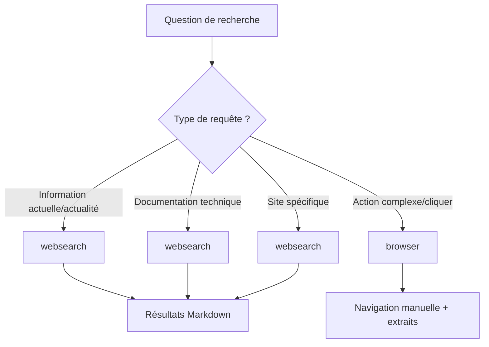

# Internet Search Skills Guide

Documentation pour les IA sur comment effectuer des recherches internet avec les outils disponibles.

---

## 🌐 Outils Disponibles

### `websearch`

Outil principal pour effectuer des recherches web en temps réel.

#### Signature
```javascript
function websearch(query: string) {
  // Retourne des résultats de recherche basés sur la requête
}
```

#### Parameters

| Paramètre | Type | Obligatoire | Description |
|-----------|------|-------------|-------------|
| `query` | `string` | ✅ | Requête de recherche (texte libre) |
| `format` | `string` | ❌ | Format de retour : "text", "markdown", "html" (défaut : "markdown") |
| `timeout` | `number` | ❌ | Délai maximal en secondes (max: 120, défaut: pas de timeout) |

#### Arguments Clés
- **`query`** : C'est l'argument principal. Doit être une chaîne de caractères représentant ce que vous souhaitez chercher.
- **`literal: false`** : Le par défaut. La recherche utilise la syntaxe des regex (regular expressions)
- **`literal: true`** : Force une correspondance exacte de texte (pas de regex)

---

## 📋 Types de Recherche Possible

### 1. 🔍 Recherche de Contenu Général

Pour obtenir des informations, articles, actualités, etc.

```
"météo Paris aujourd'hui"
"historique de la Révolution française"
"comment fonctionne le machine learning"
```

**Résultat attendu :** Des liens vers pages web avec previews et titres.

---

### 2. 🏷️ Recherche d'URL Spécifique

Pour vérifier un site, une page ou un domaine.

```
"doc.supersite.exemple est-il fiable"
"site:supersite.exemple documentation"
"https://example.com/actualité"
```

**Résultat attendu :** Résultats ciblés sur le domaine spécifique.

---

### 3. 📊 Recherche de Données Techniques

Pour obtenir des informations techniques, API, données structurées.

```
"API endpoints de Stripe"
"version npm dernière JavaScript 2024"
"data json openapi"
```

**Résultat attendu :** Informations techniques, documentation API, etc.

---

### 4. 🧠 Recherche de Connaissances Actuelles (Browsing)

Pour des informations récentes au-delà du cutoff knowledge.

```
"actualité 2026 football monde"
"nouvelle loi en vigueur 2026"
"résultats matchs aujourd'hui"
```

---

## 🎯 Formats de Requête Efficaces

### Recherche Spécifique
```javascript
query: "https://example.com/accueil"
```
→ Permet de cibler un site web précis.

### Requête Multiple Mots
```javascript
query: "météo + Paris + France 2026"
```
→ L'espace permet de séparer les concepts.

### Recherche avec Operators
```javascript
query: "météo Paris -orage +soleil 2026"
```
→ Les opérateurs `-` (exclusion) et `+` (obligatoire) peuvent être utilisés selon le moteur de recherche.

---

## 🧪 Exemples Pratiques

### Exemple 1 : Requête Simple
```javascript
query: "météo Paris aujourd'hui"
```

**Résultat typique :**
- AccuWeather
- Weather.com
- Google Weather

### Exemple 2 : Recherche de Documentation
```javascript
query: "supersite.exemple qui est ce site"
```

**Résultat typique :**
- Informations sur le projet
- Liens vers documentation existante
- Avis utilisateurs (Trustpilot, etc.)

### Exemple 3 : Recherche de Site Spécifique
```javascript
query: "site:github.com supersite"
```

**Résultat typique :**
- Repos GitHub du projet
- Documentation publique
- Liens vers le backend

---

## 📝 Limitations et Bonnes Pratiques

### ✅ Ce que l'outil fait bien :
- Fournir des liens vers pages web actualisées
- Afficher des previews de contenu (titres, extraits)
- Trouver des sources multiples pour une même requête
- Filtrer les résultats par pertinence

### ❌ Ce que l'outil ne fait pas :
- Naviguer manuellement sur des pages
- Extraire du contenu complet sans interaction
- Effectuer d'autres actions web (cliquer, télécharger, etc.)

### 💡 Bonnes Pratiques

1. **Sois spécifique** : Ajoutez des détails contextuels (année, lieu, topic).
2. **Essayez différents formats** : "text" pour un résumé court, "markdown" pour la lecture détaillée.
3. **Validez avec plusieurs sources** : Utilisez `site:` pour cibler des domaines spécifiques.
4. **Testez les dates** : Pour l'information actuelle, vérifiez que votre requête est à jour.

---

## 🔄 Alternative : Browser Tool

Si vous devez effectuer d'autres actions web (cliquer, extraire du HTML complet, etc.) :

### `browser` - Navigateur Web

Utilisez l'outil **browser** lorsque vous avez besoin de :
- Naviguer manuellement dans des pages
- Interagir avec des éléments d'interface
- Obtenir du contenu HTML brut
- Exécutez des actions complexes (scroll, cliquer, etc.)

**Outils associés :**
- `browser.tabs.open()` - Ouvrir une URL et retourner un tab ID
- `browser.tabs.list()` - Listes de tous les tabs actuels
- `browser.preview()` - Prévisualiser un fichier local ou URL

**Signature Browser :**
```javascript
function browser(url: string, format?: "text" | "markdown" | "html") {
  return navigate_and_fetch_content(url)
}
```

---

## 📚 Ressources Supplémentaires

- **Documentation complète** : `/skills/internet.md`
- **Recherche de fichiers locaux** : Utiliser `glob` ou `grep` pour chercher dans le repo
- **Recherche sur le web** : Toujours utiliser `websearch`

---

## 🚀 Résumé des Flux de Travail



---

*Généré le : 2026-10-30*
